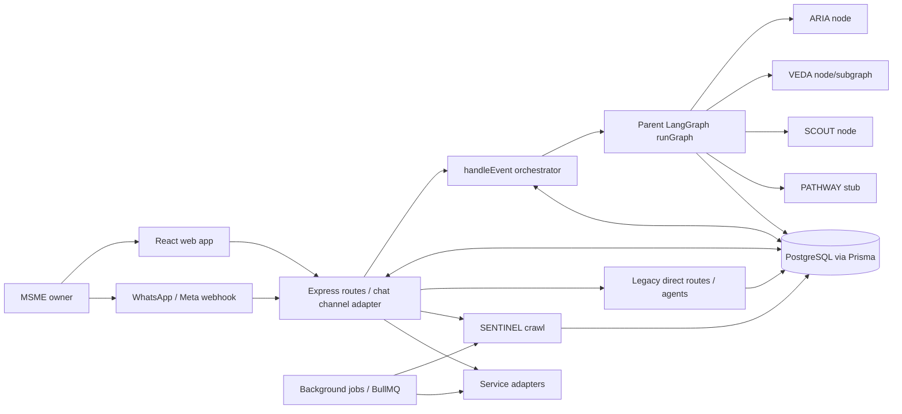
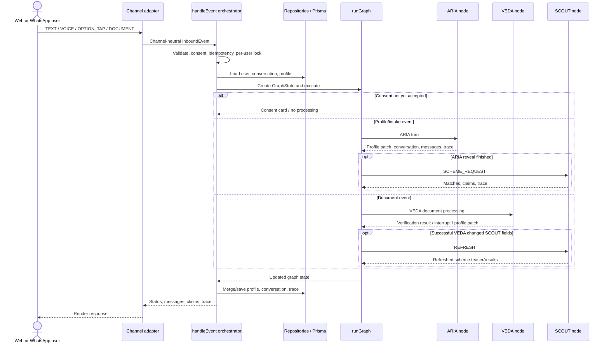
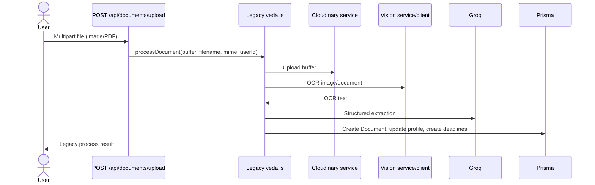
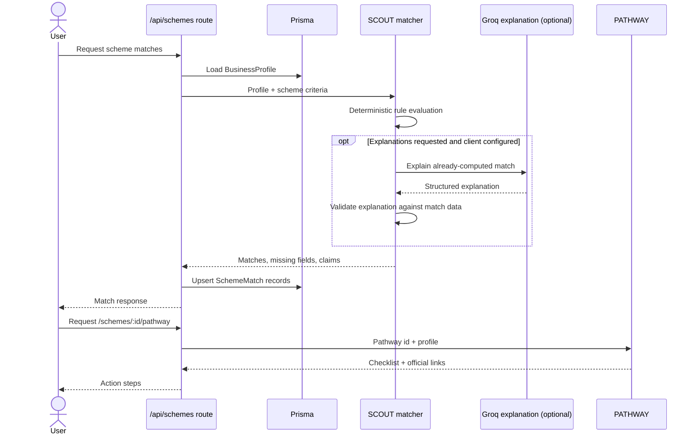
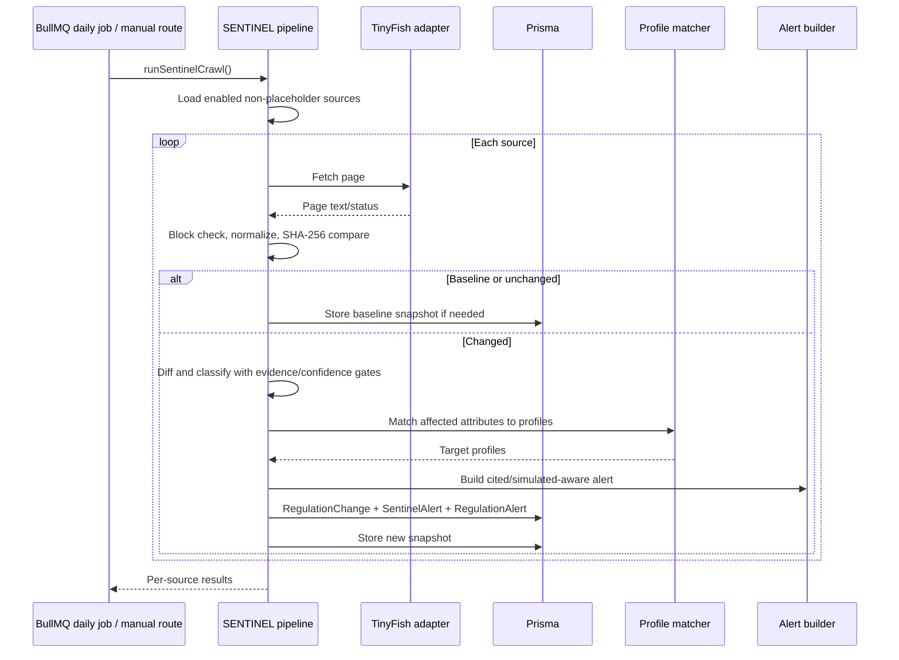
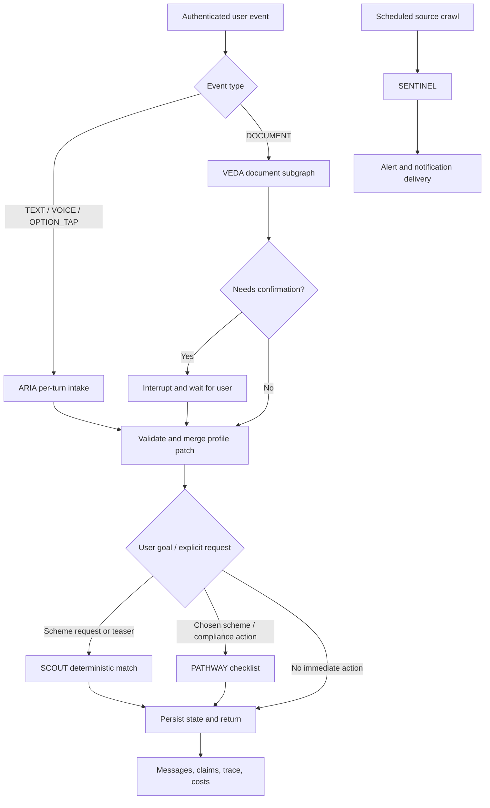

# ComplianceOS Agent Architecture

This guide explains how ARIA, VEDA, SCOUT, SENTINEL, and PATHWAY relate to each other, what executes today, where information is stored, and which connections are still planned. It is written from the checked-in Express backend, not from product diagrams alone.

## 1. Executive Summary

ComplianceOS now has a parent LangGraph workflow for consent-aware web/WhatsApp events, ARIA, VEDA, SCOUT, profile conflicts, home/menu routing, and deletion safeguards. It is not yet a complete five-agent workflow: PATHWAY is a stub node, SENTINEL runs mainly through scheduled/manual crawl and a separate delivery node, and legacy routes still coexist.

The main shared business context is the Prisma `BusinessProfile`. Users enter conversationally through ARIA; documents are processed through VEDA; SCOUT evaluates a supplied profile against scheme criteria; SENTINEL monitors regulatory sources and targets alerts; PATHWAY returns curated action checklists. Routes and jobs coordinate most of these steps. Agents generally do not invoke each other directly.

There are parallel generations in the code:

- Legacy Express agent files such as `src/agents/aria.js` and `src/agents/veda.js` are still used by existing HTTP routes.
- The parent graph uses modular ARIA (`ariaNode.js`), modular VEDA (`vedaNode.js`), and the TypeScript SCOUT event runner (`scoutNode.js`). Older graph-node adapters and direct Express agent routes also remain.
- Modular SCOUT is TypeScript with its own runner/event contract, while existing Express scheme routes still call legacy JavaScript SCOUT.
- SENTINEL is modular internally but exposed via a JavaScript wrapper to routes and jobs.
- PATHWAY is a synchronous template/rules module called by routes; it is not a graph node.

The parent graph is used by the new chat/WhatsApp event orchestration path. Direct legacy business, upload, scheme, and simulation endpoints may still bypass it. Having a graph node does not mean every route uses that node.

## 2. System Context



`handleEvent.js` is the parent orchestration boundary for channel-neutral inbound events. `runGraph.js` applies consent and deletion guards, routes the event, invokes agent/domain nodes, and returns messages, claims, trace, and state for persistence. SENTINEL remains a scheduled/manual path rather than a normal chat node; PATHWAY's parent-graph node is currently a stub. Legacy routes continue to call old agent modules directly.

### Architectural planes

| Plane | Responsibility | Current implementation |
|---|---|---|
| Channel / ingress | Accept web requests, uploads, WhatsApp webhooks | Express routes in `src/routes/` |
| Orchestration | Validate event, lock/idempotency, route nodes, persist result | `src/orchestrator/handleEvent.js` + `src/graph/runGraph.js`; legacy routes still exist |
| Agent logic | Collect, verify, match, monitor, or plan | `src/agents/` |
| External services | LLM, OCR, storage, speech, notifications, web fetch | `src/services/` |
| Durable state | Profiles, documents, deadlines, matches, alerts, sessions | Prisma models in `prisma/schema.prisma` |
| Background execution | Deadline reminders and regulatory crawls | `src/jobs/`, BullMQ/Redis or fallback timers |

## 3. The Shared Data Contract

### BusinessProfile is the main handoff object

The Prisma `BusinessProfile` is the durable profile used by existing routes and agents. It includes business identity and characteristics such as `businessType`, `sector`, `state`, `district`, `annualTurnover`, `employeeCount`, `isWomenLed`, GSTIN, Udyam number, health/penalty summaries, and an ARIA session reference.

The desired richer contract models fields with provenance (`value`, `status`, `confidence`, `source`, `evidence`). The new ARIA and SCOUT code use field-shaped profile values locally. The existing Prisma `BusinessProfile`, legacy ARIA slot map, VEDA output, and old SCOUT profile are not yet one canonical schema. Callers currently adapt, flatten, or pass whichever profile representation their implementation expects.

Consequences:

- A module must not assume every caller supplies the same profile shape.
- Field status and evidence may be lost when a rich agent patch is flattened into Prisma scalar columns.
- `VERIFIED` versus `SELF_REPORTED` policy is implemented in modular agent code but is not enforced universally by a shared profile repository layer.

### Other durable records

- `ARIASession`: legacy route chat history and `slotsFilled`; the new ARIA session is returned to its caller and is not itself persisted by the agent.
- `Document`: uploaded document metadata, OCR text, extracted JSON and review status. Current upload route/legacy VEDA owns its writes.
- `ComplianceDeadline`: deadline, source document, status, source URL and creating agent.
- `Scheme` / `SchemeMatch`: catalog and persisted results used by the legacy matching route.
- `RegulationSource`, `RegulationSnapshot`, `RegulationChange`, `RegulationAlert`, `SentinelAlert`, `TinyFishCall`: monitored source state, classification/review, delivery tracking and fetch audit.
- `Notification`: generic user notification; it is separate from SENTINEL change/delivery state.

## 4. Agent Connection Matrix

| Agent | Primary responsibility | Receives | Returns / writes | Actual callers today | Direct agent calls? |
|---|---|---|---|---|---|
| ARIA | Conversational intake/profile edits | Channel-neutral event, profile, conversation session | Messages, profile patch, updated conversation, trace | Parent graph `ariaNode`; legacy business/WhatsApp routes also call `aria.js` | On intake finish, `runGraph` chains SCOUT. |
| VEDA | OCR/document extraction and verification | DOCUMENT with HTTPS URL, metadata, profile; resume event for confirmation | Profile patch, claims, calendar/deadline records, document metadata, trace | Parent graph `vedaNode` for graph events; `/api/documents/upload` still uses legacy VEDA | On successful profile-changing document completion, `vedaNode` can chain SCOUT REFRESH. |
| SCOUT | Deterministic scheme matching and checked explanation | Profile plus `SCHEME_REQUEST`, `TEASER`, or `REFRESH` | Possible/likely matches, messages, sourced claims, trace | Parent graph `scoutNode`; legacy scheme routes still use legacy JS matcher | Called by parent after ARIA finish, VEDA profile change, or explicit menu request. |
| SENTINEL | Regulatory source changes and alert delivery | Source registry/snapshots plus profile data | Change/review records, targeted alert/digest ledgers | Scheduled/manual crawler; delivery helper/node | Separate from ordinary per-turn graph; does not invoke ARIA/SCOUT/PATHWAY. |
| PATHWAY | Action checklist | Selected action/scheme and profile | Checklist or official links | Legacy route helper exists; parent graph uses `pathwayStubNode` | Full PATHWAY implementation is not yet wired into parent graph. |

## 5. User and Background Flows

### 5.1 Parent graph event flow (new Stage B path)



This is the new channel-neutral orchestration path in `src/orchestrator/handleEvent.js` plus `src/graph/runGraph.js`. Consent, deletion, idempotency and per-user serialization are handled before/around graph execution. The parent persists the graph's conversation/profile changes and appends trace events. Legacy endpoints can still bypass this path.

### 5.2 Legacy ARIA profile intake routes

```mermaid
sequenceDiagram
    actor U as User
    participant C as Web/WhatsApp client
    participant R as Express business/WhatsApp route
    participant DB as Prisma
    participant A as Legacy aria.js
    participant S as Sarvam service (voice only)
    U->>C: Text or audio
    C->>R: /api/business/aria/chat or /aria/voice; WhatsApp webhook
    opt Voice route
        R->>S: transcribe audio buffer
        S-->>R: transcript
    end
    R->>DB: Load/create ARIASession and BusinessProfile slots
    R->>A: ariaChat(messages, currentSlots)
    A-->>R: message, extracted fields, next_slot, completion
    R->>DB: Save ARIASession; on completion update BusinessProfile
    R-->>C: Reply and session/trace metadata
```

This is the legacy `/api/business/aria/*` flow. It stores `ARIASession` and updates `BusinessProfile` after legacy ARIA reports completion. New WhatsApp text/voice events now use `channels/whatsapp.js` and `handleEvent`; `whatsappMedia.js` downloads provider audio and uses Sarvam before graph dispatch. The `/simulate-incoming` sandbox still calls legacy ARIA directly.

The modular `src/agents/aria/index.js` is a pure per-turn API. `src/graph/nodes/ariaNode.js` calls it, merges its patch via `mergeProfile`, and updates the conversation's ARIA session/outstanding cards. The orchestrator persists those changes. The older `src/graph/nodes/aria.node.js` adapter remains but is not the Stage B graph node.

The new ARIA may use Groq to extract fields from free text and classify ambiguous intents. Option taps are deterministic and should not call an LLM. It validates evidence quotes, computes bands in code, redacts sensitive identifiers before Groq, and protects verified fields in its local merge policy. These guarantees apply to the new modular code, not automatically to the older `aria.js` route implementation.

### 5.3 Document upload and VEDA



This remains the live `/api/documents/upload` path: it passes a `Buffer` to legacy `processDocument`, which owns upload, extraction and database writes. Do not confuse it with the new graph channel path.

For WhatsApp DOCUMENT events, `channels/whatsappMedia.js` downloads the provider media id, uploads the bytes to Cloudinary, and converts the event to a document URL before `handleEvent` dispatches it to the parent graph. The graph then enters `vedaNode`.

The modular VEDA graph is `intake -> ocr -> mask -> classify -> extract -> evidenceCheck -> validate -> gate -> confirm -> commit -> respond`, with an `askDocType` interrupt branch for unknown documents. It is built by `buildVedaGraph({ checkpointer })`. It uses LangGraph interrupts for doc-type/field confirmation and emits profile patches, calendar items, claims, messages, health/penalty fields, and trace. Its `commit` currently prepares output; it is not the legacy route's Prisma transaction.

`src/graph/nodes/vedaNode.js` is the Stage B node. It creates a stable VEDA thread id, stores pending confirmation metadata and TTL in `ConversationState`, resumes only the matching outstanding card/thread, merges profile changes using `mergeProfile`, saves completed documents through `documentRepo`, upserts deadlines, and refreshes SCOUT after successful relevant profile changes. The VEDA subgraph's default LangGraph saver is process-local `MemorySaver`; cross-process durability still requires a durable checkpointer. The multipart upload route remains legacy and its response contract is separate.

### 5.4 SCOUT scheme evaluation and PATHWAY checklist



The new `scoutNode.js` adapts parent graph requests to the TypeScript SCOUT event contract (`SCHEME_REQUEST`, `TEASER`, `REFRESH`) and calls `src/agents/scout/entry.ts`; the runner selects real mode only when `SCOUT_REAL === 'true'`. Its real entry uses deterministic `matchSchemes()` and optional checked explanations. Legacy `/api/schemes/*` routes still call `src/agents/scout.js` and `src/agents/pathway.js`, so both paths coexist. The modular runner retains placeholder contract/Groq interfaces; its live explanation client wiring needs verification.

SCOUT uses known profile values to evaluate criteria. Explicitly failed criteria exclude a scheme; unknown criteria remain `possible` and are surfaced as missing fields. Only after matching can optional explanation text be generated. PATHWAY is a separate route-triggered function, not an automatic action from the match engine.

### 5.4 SENTINEL crawl and alert delivery



SENTINEL runs independently of user turns: a BullMQ daily crawl is registered in `sentinelCrawler.js`; manual route/admin triggers also exist. `runSingleSource()` fetches through TinyFish, rejects blocked/captcha pages, normalizes text, stores snapshots, diffs changes, and invokes classifier/matcher/alert builder. A change under the confidence/quote gate is sent to review instead of delivered. Alerts are persisted separately from source-change delivery records.

The current pipeline loads eligible business profiles before matching, then passes approved changes and profiles to `sentinelDeliveryNode.js`. That node enforces source/evidence requirements, per-user/change dedupe, immediate-alert limits, and digest fallback before calling the shared notifier. Placeholder source URLs are still skipped, so those sources do not crawl live.

### 5.6 Deadline notification flow

VEDA/legacy routes may create compliance deadlines in Prisma. The deadline job queries pending deadlines and sends 1/3/7-day reminders through `services/notify.js`, which applies channel-window/template rules and dedupe. The reminder job does not ask agents to calculate reminders.

## 6. Service and Model Boundaries

### Service calls

| Service | Used by | Purpose / boundary |
|---|---|---|
| Groq SDK / `services/groq.js` | Legacy agents may call SDK directly; modular ARIA/SCOUT integrations are separate or injected | Structured extraction/explanations only; never deterministic eligibility, validation, routing, or penalty math |
| Google Cloud Vision / `services/vision.js` | Modular VEDA OCR pipeline; legacy VEDA may use its own client path | Image/document OCR |
| Cloudinary / `cloudinaryService.js` | Legacy document upload flow | Buffer upload and storage URL/id |
| Sarvam / `sarvamService.js` | Business voice route | Speech-to-text, optional TTS/translation |
| TinyFish / `tinyfish.js` | SENTINEL; modular SCOUT verification/discovery via injected client | External web fetch/search/agent operations with block/rate controls |
| WhatsApp / `whatsappService.js` | WhatsApp route, notifications, deadline reminders | Outbound messages; transport only |
| Prisma / `db.js` | Routes, jobs and SENTINEL persistence | Shared durable relational state |

The codebase contains more than one adapter generation. For any particular flow, follow its imports: using a service somewhere does not imply every agent uses that adapter.

### Important relationships

- `User` owns one `BusinessProfile`; ARIA session rows and uploaded documents associate to users.
- `Document` can own multiple `ComplianceDeadline` rows through `sourceDocumentId`.
- `BusinessProfile` has `SchemeMatch` rows; each match references a `Scheme`.
- `RegulationSource` owns snapshots, changes, and TinyFish call records; `RegulationChange` may own user delivery rows (`RegulationAlert`).
- `SentinelAlert` is a user-facing view record; `Notification` is a generic notification record.
- `traceRepo` persists parent graph trace events with `runId`/user attribution. `/api/agent-trace` still assembles a separate presentation summary from profile, recent documents, deadlines, and alerts; it is not the correlated trace query endpoint.

## 7. Message, Control, and State Handoffs

### Control flow versus data flow

- **Control flow** for channel-neutral events is decided by `handleEvent` + `graph/router.js` + `runGraph.js`; legacy direct routes and BullMQ schedules coexist.
- **Data flow** is the profile, extracted document fields, scheme matches, deadlines, regulatory changes, and notifications passed in arguments or stored in Prisma.
- **User interaction flow** is represented by HTTP/WhatsApp responses and, in the modular graph paths, LangGraph interrupt payloads.

The shared profile is a data handoff, not an event bus. In the new parent graph, ARIA chains to SCOUT when intake finishes; VEDA refreshes SCOUT after a successful relevant profile change. A SENTINEL alert does not automatically start PATHWAY; home/menu routing currently reaches a PATHWAY stub.

### State ownership

| State | Owner today | Persistence |
|---|---|---|
| Legacy ARIA conversation | `/api/business/aria/*` route | Prisma `ARIASession`, then profile update when complete |
| Parent-graph ARIA conversation | `ConversationState` through `ariaNode` | `handleEvent` persists conversation/profile via repositories |
| Legacy uploaded document | `processDocument()` in `src/agents/veda.js` | Prisma `Document`, `BusinessProfile`, and deadlines; upload to Cloudinary |
| Parent-graph VEDA pending state | `ConversationState.pendingVeda` | Thread/card/document metadata plus TTL persisted by conversation repository; LangGraph saver defaults to process-local MemorySaver unless injected |
| SCOUT match | Parent graph or legacy scheme route | Parent returns claims/messages; legacy scheme route also upserts Prisma `SchemeMatch` |
| SENTINEL source/change | SENTINEL pipeline | Prisma snapshots/changes and alert delivery records |
| PATHWAY output | Route response | Templates are generated at request time; no independent agent state |

## 8. Failure, Trust, and Observability

- **ARIA**: The new per-turn agent validates inputs/outputs, requires quoted evidence for extracted updates, redacts sensitive text before Groq, and returns a safe degraded response. Legacy ARIA follows a different code path and does not inherit all new guarantees automatically.
- **VEDA**: The modular graph isolates node errors, prevents extraction after unclear OCR, gates low-confidence/failed validation fields, and interrupts for confirmation. Legacy upload currently has separate parsing and persistence behavior.
- **SCOUT**: Rule code decides match status; unknown criteria stay possible. Parent graph uses `scoutNode`; explanations are optional, validated, and can fall back to templates. Modular contract/service placeholders still need integration review.
- **SENTINEL**: Placeholder URLs and blocked pages are skipped; low confidence or missing evidence prevents alert delivery. Simulated sources/alerts must remain labeled.
- **PATHWAY**: Provides guidance and links only. It does not log in, store credentials, or auto-file; check each template's source and wording before treating it as authoritative.

The event orchestrator appends graph traces through `traceRepo`; service adapters scrub sensitive values. `/api/agent-trace` remains a separate synthesized status summary and does not yet expose a fully correlated end-to-end trace for every legacy route/job.

## 9. Current Versus Target Connections

| Connection | Status |
|---|---|
| Web/WhatsApp event → consent/idempotency → parent graph → repositories | Implemented through `handleEvent` and `runGraph` |
| Parent ARIA → SCOUT on intake completion | Implemented in `runGraph` |
| Parent VEDA → SCOUT refresh after relevant verified profile change | Implemented in `vedaNode` |
| WhatsApp voice/document → provider media → Sarvam/Cloudinary → graph event | Implemented in `whatsappMedia.js`; live provider details still need verification |
| `/api/documents/upload` → modular VEDA | Still legacy; separate Buffer upload/response contract remains |
| PATHWAY parent graph action | Stub only; legacy route helper remains available |
| SENTINEL crawl → approved change → deduped alert/digest → notify | Pipeline/job and delivery protections implemented; placeholder sources remain skipped |
| One graph that runs all five agents on every event | Not intended/currently absent; SENTINEL stays scheduled and PATHWAY is action-triggered |

## 10. Remaining Integration Work

The parent graph now coordinates normal web/WhatsApp turns without agents importing each other. Remaining work is to finish boundary integration rather than invent another orchestrator:

- Migrate `/api/documents/upload` from legacy VEDA while preserving upload, persistence, API response and confirm/resume behavior.
- Replace/integrate modular agent placeholder contracts with the shared contracts and keep profile projections/provenance intact.
- Wire a durable LangGraph checkpointer for VEDA interrupts across process restarts.
- Replace `pathwayStubNode` with the real checklist implementation and verify official links/claims.
- Verify provider contracts and limits (Sarvam formats/models, WhatsApp interactive limits, TinyFish behavior) before production configuration.
- Keep SENTINEL source URLs verified and keep its scheduled flow isolated from per-turn intake.



Architecture invariants:

1. The parent passes a canonical profile and event contract to agents; adapters convert legacy scalar DB fields to provenance-aware fields at the boundary.
2. Agents return patches and claims; one profile repository/merge policy decides persistence and protects `VERIFIED` values.
3. LangGraph `thread_id` is stable across a user session, and production uses a durable checkpointer for interrupts/resume.
4. Event routing is deterministic code. No agent invents another agent's input or routes based on LLM prose.
5. SCOUT consumes the merged profile but does not own it; PATHWAY only runs from an explicit selected action; SENTINEL stays on an independent timer/event path.
6. Correlated trace events carry the same parent `runId` and agent-specific child spans; persist through `traceRepo` and distinguish them from summary telemetry.

## 11. How to Explain It

A concise external explanation:

> ARIA collects a business profile, VEDA verifies facts from uploaded documents, SCOUT compares that profile with scheme rules, PATHWAY turns a selected option into a checklist, and SENTINEL watches regulatory sources for changes. They share information through the profile and database, while routes and scheduled jobs decide which agent runs. The repository is migrating toward graph-based orchestration, but not all five agents are currently mounted into one live graph.

A technical explanation should then show the relevant entry point, contract, service calls, persistence owner, and failure/confirmation path for the specific flow being discussed. Do not claim a direct agent handoff unless the import/call path exists.
